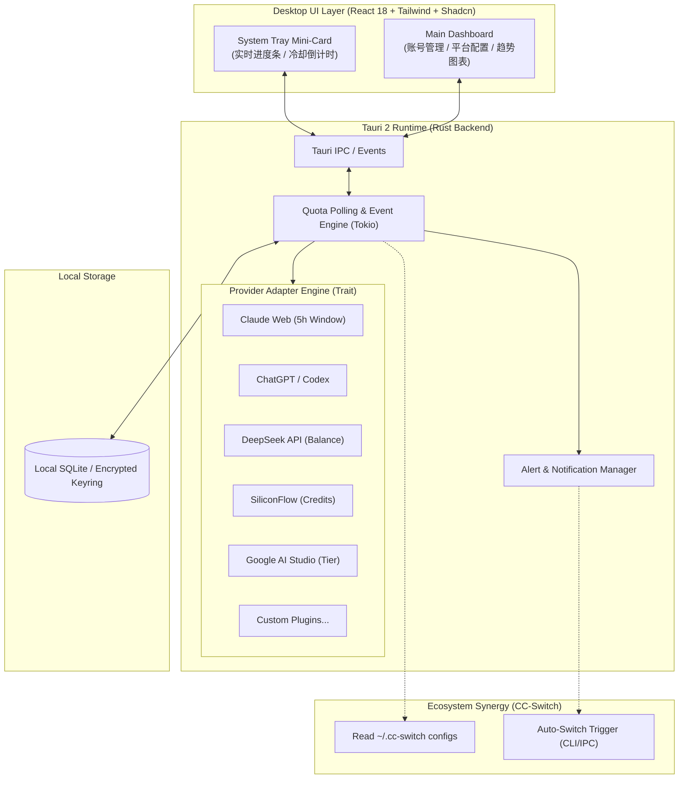

# QuotaWatcher ⏱️⚡

  <b>Personal Multi-Account Quota Sentinel & Auto-Failover Engine</b> 
  <i>全平台 AI 与云服务多账号额度管家：实时监控、耗尽告警、智能切号</i>

  
  
  
  

---

## 💡 为什么需要 QuotaWatcher？(The Pain Point)

进入 AI Agent 与高频代码助手时代，几乎所有开发者都拥有跨多个平台的大量账号：
- **滚动窗口受限型**：Claude.ai Pro/Team (5 小时限额)、ChatGPT Plus (3 小时限额)
- **按量余额消耗型**：DeepSeek、硅基流动 (SiliconFlow)、OpenRouter、OpenAI API
- **周期免费重置型**：Google AI Studio (15 RPM / 1500 RPD 免费层)、Cloudflare Workers、Vercel

### 典型痛点：
1. **写代码写到一半被中断**：敲命令突然抛出 `Rate Limit Exceeded`，才慌忙去找哪个备用号还有额度。
2. **账号太多记不住**：手握多个小号或工作号，完全不清楚每个号当前还剩多少余额、哪个号何时冷却重置。
3. **缺乏自动联动**：现有的切号工具（如 `cc-switch`）需要人工手动切换；没有“额度耗尽自动感应并触发无缝切号”的完整闭环。

**QuotaWatcher 就是为了彻底解决这一断层而生。**

---

## ✨ 核心特性 (Key Features)

- 📊 **全形态额度统一建模**：无论是“5 小时滚动窗口倒计时”，还是“人民币/美元余额”，亦或是“每日请求计数”，统一以直观的仪表盘和进度条呈现。
- 🖥️ **极轻量系统托盘小部件**：常驻 Windows 托盘 / macOS 菜单栏。轻点托盘图标即可唤出毛玻璃悬浮卡片，工作时扫一眼即可掌握全局。
- 🔄 **深度协同 `cc-switch`（Auto-Failover 闭环）**：
  - **零门槛导入**：自动探测并导入 `~/.cc-switch/` 中的 Provider 账号。
  - **无感续命**：主账号额度耗尽瞬间，自动发送切号指令至 `cc-switch`，实现 Coding 过程零停顿。
- 🔔 **多通道阈值告警**：支持系统弹窗通知、Bark、Telegram Bot、飞书/企业微信 Webhook。
- 🔒 **100% Local-First 隐私安全**：所有 Cookie、Token 和 API Key 仅保留在用户本机 SQLite 及系统级钥匙串（Keyring）中，绝不上传任何云端。

---

## 🏛️ 架构设计 (Architecture)

---

## 🔌 首期支持平台计划 (Roadmap)

- [ ] **Phase 1: 核心三巨头**
  - [ ] **Claude.ai 网页版**（通过 Session Key 抓取 5h 剩余额度与重置精确时间）
  - [ ] **DeepSeek 官方 API**（账户余额、代金券状态）
  - [ ] **硅基流动 (SiliconFlow)**（实时余额与 Token 统计）
- [ ] **Phase 2: 开发者主流模型**
  - [ ] **ChatGPT 网页端 / Codex**（3h 用量检测）
  - [ ] **Google AI Studio / Gemini**（免费 RPM / RPD 监控）
  - [ ] **OpenRouter**（Credit 实时查询）
- [ ] **Phase 3: 云服务与生态联动**
  - [ ] **`cc-switch` 配置一键无缝同步**
  - [ ] **额度耗尽自动切号 Webhook / IPC**
  - [ ] **Cloudflare Workers / Vercel 免费额度**

---

## 🛠️ 技术栈 (Tech Stack)

* **桌面框架**：[Tauri 2.0](https://v2.tauri.app/) (Rust)
* **前端界面**：[React 18](https://react.dev/) + [TypeScript](https://www.typescriptlang.org/)
* **样式与组件**：[Tailwind CSS](https://tailwindcss.com/) + [Radix / Shadcn UI](https://ui.shadcn.com/) + [Lucide Icons](https://lucide.dev/)
* **网络与并发**：[Tokio](https://tokio.rs/) + [Reqwest](https://docs.rs/reqwest/)
* **本地存储**：SQLite (rusqlite / sqlx) + 系统原生密钥链

---

## 🤝 与 `cc-switch` 生态合作

QuotaWatcher 设计之初即充分尊重并兼容 `cc-switch` 的架构哲学：
* **互补而不冲突**：`cc-switch` 专攻环境与配置切换；`QuotaWatcher` 专攻用量监控、倒计时与自动熔断触发。
* **协议开放**：对外提供标准 Local HTTP / IPC 接口，任何第三方工具均可订阅 QuotaWatcher 的额度事件。

---

## 📄 开源许可证

本项目基于 [MIT License](LICENSE) 开源。欢迎 Star、Fork 与提 Issue！
